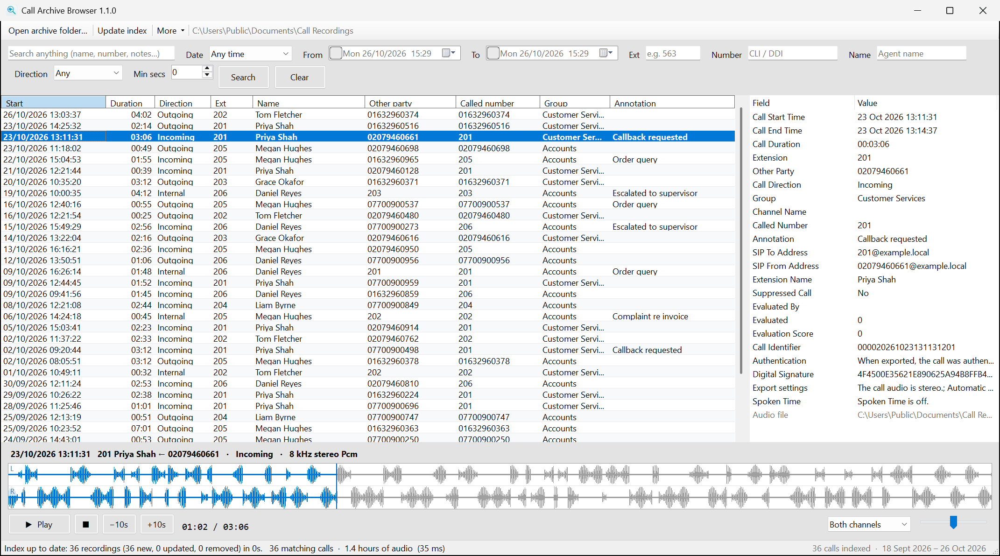
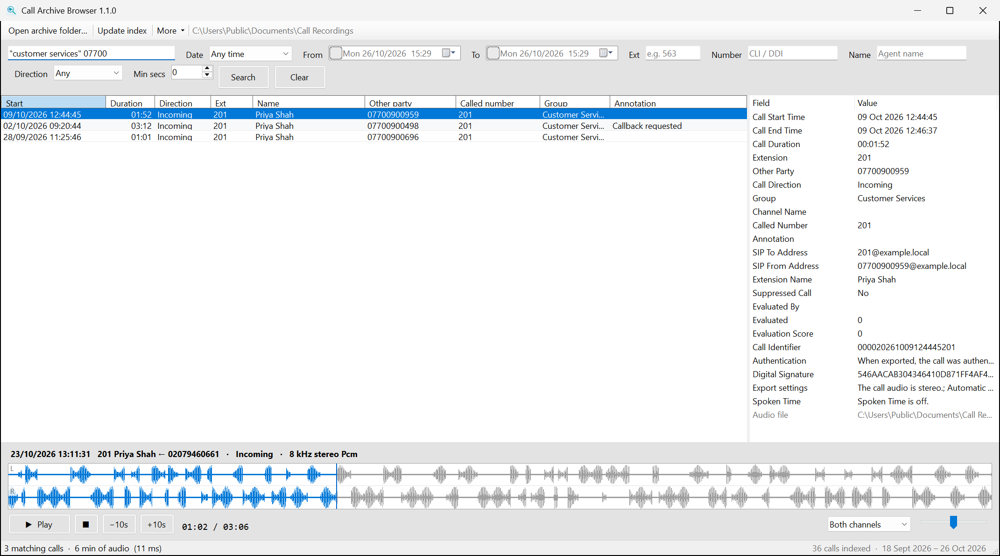
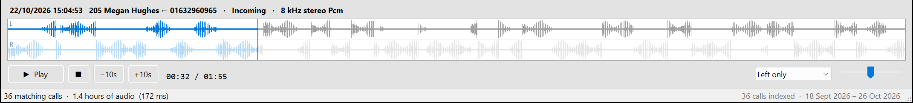

# Call Archive Browser

`CallArchiveBrowser.exe` is a Windows tool for finding and replaying calls in an archive exported
from a call recorder. Each call in the archive is a `.wav` recording plus a "Call Export" text file
(`.wav.txt` or `.txt`). Point the tool at the archive folder and it builds a fast local index. You
can then search by date, extension, agent, phone number or any other metadata and play calls back
with a waveform view of both sides of the conversation.

This repository holds the published releases only. Download the latest from
[Releases](../../releases/latest). Once installed, the app keeps itself up to date (see
[Updates](#updates)).



- [What you need](#what-you-need)
- [Install](#install)
- [Open your archive](#open-your-archive)
- [Search for calls](#search-for-calls)
- [Play a call](#play-a-call)
- [Call details](#call-details)
- [Export and copy calls](#export-and-copy-calls)
- [Keeping the index up to date](#keeping-the-index-up-to-date)
- [Updates](#updates)
- [Keyboard shortcuts](#keyboard-shortcuts)
- [Where things are stored](#where-things-are-stored)
- [Troubleshooting](#troubleshooting)

## What you need

- **Windows 10 or 11 (64-bit).** Nothing else needs installing: the exe includes everything it
  needs, which is why it's about 70 MB.
- **Read access to the call archive.** It can be a local folder, a mapped drive or a network
  share (`\\server\share\...`), and read-only access is enough. The tool never changes, moves
  or deletes anything in the archive.
- **The archive in the recorder's export format.** Each call is a `.wav` file with a metadata
  file next to it, called either `name.wav.txt` or `name.txt`. Any folder layout works, for
  example everything in one folder, or `year\month\day\extension\` folders at any depth.
- **Internet access to GitHub** for automatic updates (optional; see [Updates](#updates)).

## Install

1. Download `CallArchiveBrowser.exe` from the [latest release](../../releases/latest).
   Optionally check it against the release's `CallArchiveBrowser.exe.sha256` by running
   `Get-FileHash CallArchiveBrowser.exe` in PowerShell. The two values should match.
2. Put it in a folder **you can write to**, for example `Documents\Call Archive Browser` or your
   Desktop. Updates replace the exe in that folder, which isn't possible under `C:\Program Files`
   without administrator rights.
3. Double-click it to start. The first time, Windows may show *"Windows protected your PC"*
   because the exe isn't code-signed. Click **More info**, then **Run anyway**. Updates
   installed by the app itself don't ask again.

There's no installer and nothing to uninstall: to remove the tool, delete the exe and the
folder `%LOCALAPPDATA%\CallArchiveBrowser`.

## Open your archive

1. Click **Open archive folder…** and choose the top folder of the archive. Sub-folders are
   included automatically.
2. The first time you open a folder, the tool indexes it. Progress is shown at the bottom of
   the window, and the **Update index** button becomes **Cancel indexing** while it runs. You
   can start searching as soon as it finishes.
   - Indexing reads each metadata file once. Expect it to take from seconds for a few thousand
     calls to several minutes for 100,000+ calls on a network share.
   - Calls are listed newest first. The status bar shows how many calls are indexed and the date
     range they cover.
3. Next time you start the tool, it reopens the same archive straight away.

You can switch between archives with **Open archive folder…**. Each archive keeps its own
index, so switching back is instant.

**Calls without a metadata file** are still indexed. The date and time are taken from the file
name (`2023-01-02-10-23-25.wav`) or from the folders (`2023\01\02\` plus `10-23-25.wav`), the
extension from an extension-number folder if there is one, and the duration from the recording.
The details pane shows *"No metadata file found"* for these calls.

## Search for calls



All the filters work together, and the list updates as soon as you press **Enter** or click
**Search**. **Clear** resets every filter.

| Filter | How it works | Examples |
|--------|--------------|----------|
| **Search box** | Matches any metadata field: names, numbers, SIP addresses, group, annotation, call identifier and file name. Several words must all match; put a phrase in quotes. | `smith 0161` · `"customer services" 07700` |
| **Date** | A quick range: Today, Yesterday, Last 7 days, Last 30 days, This week, Last week, This month, Last month, This year, Last year. Weeks start on Monday. | *Last month* |
| **From / To** | Tick the box to set your own date and time. Both ends are included: *To 14:30* includes calls that started at 14:30:59. Setting these switches the Date list to *Custom range*. | From *01/10/2026 09:00* |
| **Ext** | One extension, a list, or a wildcard. | `563` · `563,564` · `56*` |
| **Number** | Any part of the other party's number, the called number or the SIP addresses. Spaces are ignored. | `07700 900` · `1632` |
| **Name** | Any part of the agent (extension) name. | `shah` |
| **Direction** | Incoming, Outgoing, Internal, or whatever directions your archive contains. | *Incoming* |
| **Min secs** | Only calls at least this long. Useful for skipping missed and very short calls. | `60` |

- **Sort** by clicking a column header; click it again to reverse the order.
- **Select several calls** with Ctrl-click or Shift-click, or press **Ctrl+A** to select every
  result.
- **Right-click** a call for: Play, Open file location, Open metadata file, Copy file path, Copy
  selected recordings to folder, and Export results to CSV.
- Up to 250,000 results are listed at once. If a search matches more, the status bar says so;
  narrow the search to see the rest.

**More → Search tips** shows a short summary of the above inside the app.

## Play a call

Double-click a call, or select it and press **Enter**.



- **The waveform** shows the whole call. On stereo recordings there are two lanes, one for
  each party: usually the agent on **L** (left) and the other party on **R** (right). You can
  see at a glance who was talking when, and where the silences are.
- **Click or drag on the waveform** to jump to that point. Hover over it to see the time at the
  mouse position. The part already played is shown in blue.
- **Play/Pause**, **Stop**, and **−10s / +10s** are under the waveform, with the position and
  length next to them.
- **Both channels / Left only / Right only** lets you listen to one side of the call on its
  own. The muted side is faded in the waveform. The setting is remembered.
- **Volume** goes up to 200%, for quiet recordings.
- The line above the waveform shows the call's date, extension and agent, the other party
  (← incoming, → outgoing, ↔ internal), and the recording format.

Recordings in µ-law, A-law, GSM and ADPCM formats are converted automatically as they play.

## Call details

The pane on the right shows every field from the selected call's metadata file, including the
call identifier, the recorder's digital signature and the export settings. The full path of the
recording is at the bottom.

Right-click a field to **Copy value**, or **Copy all** to copy every field as text.

## Export and copy calls

Both are under **More**, and on the right-click menu:

- **Export results to CSV…** saves every call in the current result list (not just the selected
  ones) as a CSV file that opens in Excel. The columns are start time, duration in seconds,
  direction, extension, name, other party, called number, group, annotation, and the full paths
  of the audio and metadata files.
- **Copy selected recordings to folder…** copies the selected calls' `.wav` and metadata files
  to a folder you choose, for example to send them to someone. Files already in the destination
  are skipped, never overwritten. The archive itself is left as it was.

## Keeping the index up to date

The index doesn't watch the archive for changes. When calls have been added to the archive,
click **Update index**. Only new or changed files are read, so this is much quicker than the
first index. Calls whose files have been deleted are removed from the index.

If a folder can't be read during an update, for example because the network share dropped out
for a moment, its calls are **kept** in the index rather than treated as deleted. The status bar
says how many folders were skipped, and the details are written to `index-errors.log` (see
[Where things are stored](#where-things-are-stored)).

**More → Rebuild index from scratch** discards the index and reads every recording again. Your
recordings are not touched. You should rarely need this.

## Updates

Updates are automatic:

1. Each time the app starts, it checks this repository for a newer release.
2. If there is one, it downloads it in the background and checks it against the release's
   SHA-256 checksum. You can keep working while this happens.
3. A green **Update available** button appears in the toolbar (hover over it to see the version).
   Click it to restart into the new version straight away, or just carry on: the update installs
   itself when you close the app, and the next time you open it you're on the new version.

Your settings and indexes are kept. If anything goes wrong (no connection, a failed checksum),
the current version simply carries on.

- **Check by hand:** **More → Check for updates…** shows the release notes and offers to
  install.
- **If the exe's folder isn't writable** (for example `C:\Program Files` or a read-only network
  location), the app can't replace itself. The button then offers to open the release page so
  you can download the new version yourself. Moving the exe to a folder you can write to fixes this.
- **Network:** outbound HTTPS to `api.github.com`, `github.com`, `objects.githubusercontent.com`
  and `release-assets.githubusercontent.com`. If these are blocked, the app works normally but
  doesn't update. Download new versions from [Releases](../../releases) instead.
- **Go back to an older version:** download it from [Releases](../../releases) and replace the
  exe. Note that it will update itself to the latest version again, so only do this while a
  fixed release is on its way.

## Keyboard shortcuts

| Key | Action |
|-----|--------|
| **Enter** (in the results) | Play the selected call |
| **Space** (in the results) | Play / pause |
| **Ctrl+→ / Ctrl+←** | Skip forward / back 10 seconds |
| **Ctrl+F** | Go to the search box |
| **Enter** (in a filter box) | Search |
| **F5** | Run the search again |
| **Ctrl+A** (in the results) | Select all results |

## Where things are stored

Everything the app writes is under `%LOCALAPPDATA%\CallArchiveBrowser` (**More → Open index data
folder** opens it):

```
settings.json              last archive folder, window size, volume, channel setting
index-<folder>-<id>.db     one index per archive folder (about 250 bytes per call)
index-errors.log           files and folders that couldn't be read in the last index run
error.log                  details of any unexpected error
```

The index is only a cache. Deleting it is safe: the archive is re-indexed next time you open it.
Nothing is sent anywhere. The only network access is the update check.

## Troubleshooting

| Symptom | Likely cause | What to do |
|---------|--------------|------------|
| "Windows protected your PC" on first run | The exe isn't code-signed | **More info → Run anyway** |
| No calls found after indexing | Wrong folder, or the recordings aren't `.wav` files | Open the folder that contains the recordings (or a folder above it) |
| A call shows no name or number | It has no metadata file next to the `.wav` | Check the `.wav.txt` / `.txt` is in the same folder with the same name |
| New calls don't appear | The index isn't updated automatically | Click **Update index** |
| "The recording file can't be found" | The file has been moved or deleted since indexing | Click **Update index** |
| "Couldn't play this recording" | The file is damaged or in an unsupported format | Try opening it in another player; check `error.log` |
| "N files could not be read" after indexing | Damaged files or no permission | See `index-errors.log` for the list |
| "N folders could not be opened (their calls were kept)" | A folder was unreachable during the update, e.g. the share dropped out | Click **Update index** again when the share is back |
| Indexing a network share is slow | The first index reads every metadata file over the network | Let it finish once; later updates only read new files |
| No update button although a new release exists | GitHub isn't reachable, or the check is still running | Wait a minute, or use **More → Check for updates…** |
| The update button opens a web page instead of updating | The exe's folder isn't writable | Move the exe to a folder you can write to (see [Install](#install)) |
| Something else went wrong | — | Send `error.log` from `%LOCALAPPDATA%\CallArchiveBrowser` with a description of what you were doing |
